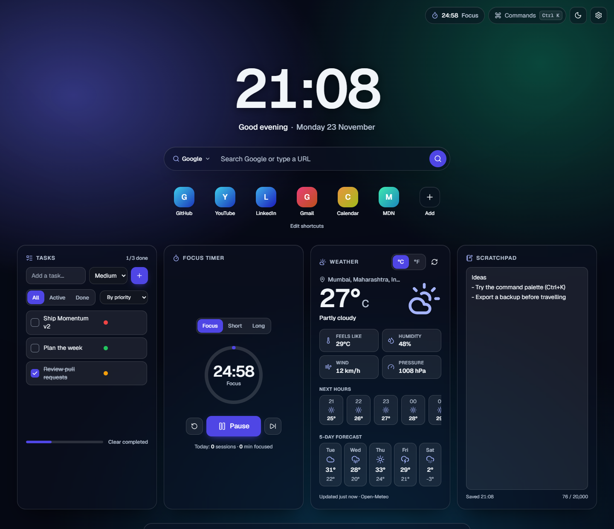
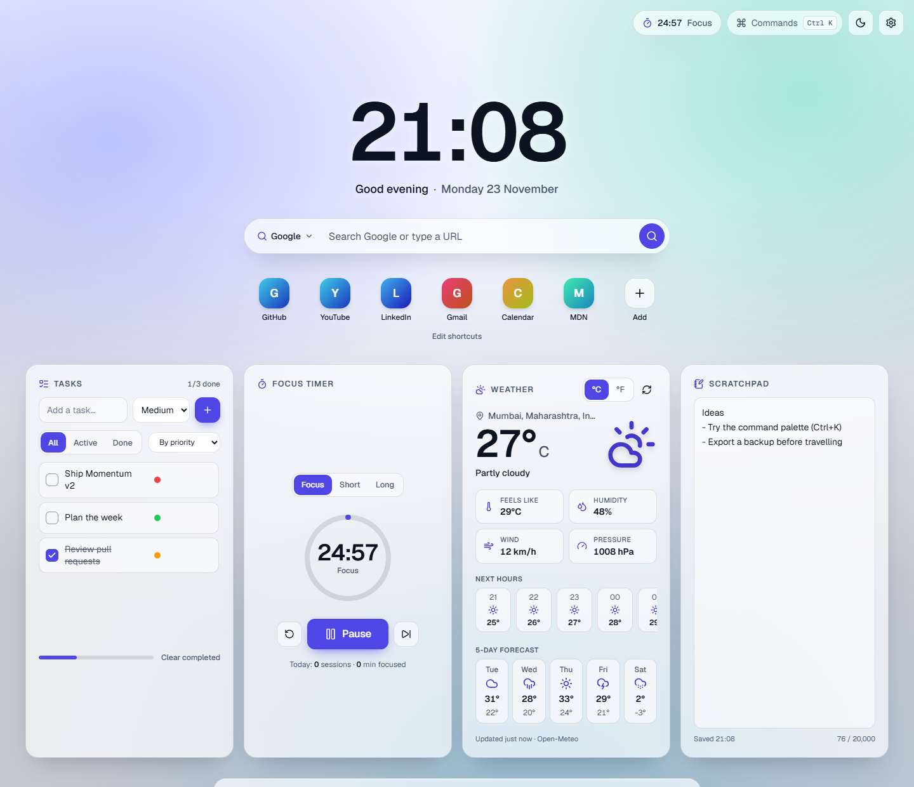
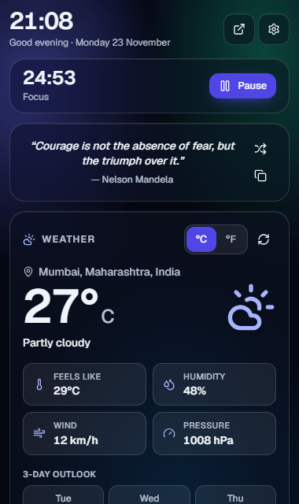
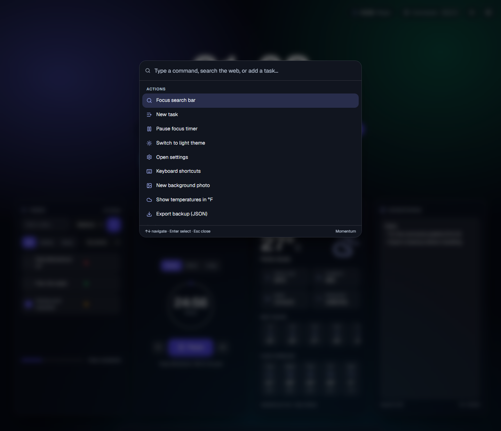
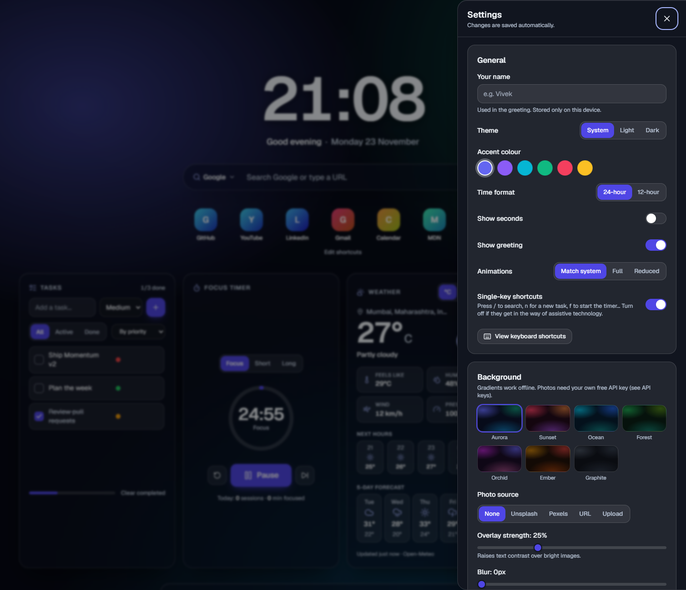

# Momentum Dashboard — Chrome New Tab Extension

[](https://github.com/Slv-WebTech/chrome-extension/actions/workflows/ci.yml)

A fast, private **Manifest V3** new-tab dashboard built with **Next.js 16, React 19, TypeScript, Redux Toolkit and Tailwind CSS 4**.
Every new tab becomes a calm workspace: search, shortcuts, live weather with forecast, prioritised tasks, a Pomodoro focus timer, a scratchpad and a quote of the day — with polished light/dark themes, a command palette, full keyboard support and **no accounts, no analytics and no API keys required**.

| Dark | Light |
| --- | --- |
|  |  |

| Toolbar popup | Command palette | Settings |
| --- | --- | --- |
|  |  |  |

**Live demo (web build, same code):** <https://slv-webtech.github.io/chrome-extension/>

## Features

**Dashboard**
- Large clock with greeting, 12/24-hour format and optional seconds.
- **Search bar with engine selector** — Google, DuckDuckGo, Bing, Brave, Startpage, Ecosia, YouTube, GitHub, Stack Overflow, Wikipedia, Google Maps or your own `https://…%s` template. Type `!yt lofi`, `!gh next.js`, `!w turing`… to switch engine for one search. Typing an address opens it directly. Recent searches (local, optional, clearable).
- **Quick links** — add, edit, remove and reorder shortcuts (keyboard accessible). Letter tiles are generated locally, so no favicon service ever sees your browsing.
- **Weather** — current conditions, feels-like, humidity, wind, pressure, next hours and a 5-day forecast. °C/°F and km/h/mph/m·s⁻¹. Works out of the box with [Open-Meteo](https://open-meteo.com/) (no key); use your own OpenWeather key if you prefer. City search or one-click "Locate me" with the browser's geolocation (you are always asked by Chrome). Cached and refreshed in the background; shows the last data when offline.
- **Tasks** — priorities (High/Medium/Low, or type `!high` inline), All/Active/Done filters, sort by priority or date, inline edit, undo delete, progress bar.
- **Focus timer (Pomodoro)** — focus / short / long phases with configurable lengths, auto-start, chime, today's sessions and minutes, countdown in the tab title, and an optional desktop notification that fires even if the tab is closed.
- **Scratchpad** — autosaved notes.
- **Quote of the day** — 60+ bundled quotes (works offline), shuffle, copy; optional online source.
- **Backgrounds** — 7 built-in gradient themes (offline), or a daily photo from Unsplash/Pexels with *your own* free key, an image URL, or an uploaded image (kept on-device). Overlay strength and blur sliders keep text readable.

**Power features**
- **Command palette** (`Ctrl/⌘ + K`): run commands, search the web, open links, add a task, complete a task, switch engine or accent, toggle the timer/theme, export data.
- **Keyboard shortcuts**: `/` search · `n` new task · `f` start/pause timer · `d` theme · `,` settings · `?` help. Single-key shortcuts can be switched off (WCAG 2.1.4).
- **Settings** (drawer on the new tab, full page via *Options*): theme (system/light/dark), six accent colours, widget visibility, animations (system/reduced/full), engine, weather provider/units, timer lengths, quote source, API keys.
- **Backup & restore** — export/import everything as JSON; API keys are **excluded unless you tick the box**.
- **Toolbar popup** — the compact "Daily Boost" view (clock, quote, weather) plus quick tasks and the focus timer.
- Settings, tasks and notes sync between the popup and every open new tab instantly.

**Quality**
- Glassmorphism UI with smooth, reduced-motion-aware animations, responsive from phone widths to ultra-wide.
- Accessible: semantic landmarks, skip link, labelled controls, ARIA roles/states, visible focus rings, live regions, AA contrast (verified with axe in both themes).
- Strict extension CSP, no remote code, minimal permissions (below).

## Install (unpacked)

Requirements: **Node.js ≥ 20.9** and **pnpm 10** (`npm i -g pnpm`).

```bash
git clone https://github.com/Slv-WebTech/chrome-extension.git
cd chrome-extension
pnpm install
pnpm build          # -> ./out  (a ready-to-load Manifest V3 extension)
```

Then in Chrome / Edge / Brave:

1. Open `chrome://extensions` and switch on **Developer mode**.
2. Click **Load unpacked** and select the **`out`** folder.
3. Open a new tab. The toolbar icon opens the compact popup; *Options* opens full-page settings.

Package for sharing / the Chrome Web Store: `pnpm package` → `release/momentum-dashboard-v<version>.zip`.

> Chrome allows only one new-tab override at a time. If another extension owns the new tab page, disable it first.

## Permissions & privacy

| Permission | Why |
| --- | --- |
| `storage` | Saves your settings, tasks, notes and shortcuts in `chrome.storage.local` on this device. |
| `alarms` | Lets the focus timer wake the background worker when a phase ends. |
| `notifications` *(optional)* | Only requested if you turn on "Desktop notification when a phase ends". |

No host permissions, no content scripts, no `tabs`/`history`/`cookies` access. Geolocation uses the standard browser prompt, only when you ask for it. The extension CSP is `script-src 'self'` with an explicit `connect-src` allow-list — it cannot load or run remote code.

**What leaves your device** (only when you use the feature; nothing is sent in the background otherwise):

| Service | Purpose | Data sent |
| --- | --- | --- |
| `api.open-meteo.com` | Weather and forecast (default) | Rounded coordinates |
| `geocoding-api.open-meteo.com` | City search | The text you type |
| `api.bigdatacloud.net` | Place name for "Locate me" | Coordinates |
| `api.openweathermap.org` | Weather if you choose OpenWeather | Coordinates + *your* key |
| `api.unsplash.com`, `api.pexels.com` | Optional daily photo | Topic + *your* key |
| `api.freeapi.app` | Optional online quotes | Nothing |

No account, no analytics, no telemetry, no ads. API keys you enter are stored only in `chrome.storage.local` (never synced) and are never baked into the code. See [`.env.example`](.env.example).

## Using it

| Do this | To get this |
| --- | --- |
| `Ctrl/⌘ K` | Command palette |
| `/` · `n` · `f` · `d` · `,` · `?` | Search · new task · timer · theme · settings · help (when not typing) |
| `!yt cats`, `!gh react`, `!w ada lovelace` | Search another engine once (`!g !d !b !br !sp !e !yt !gh !so !w !m`) |
| `Buy milk !high` | Adds a high-priority task (`!medium`, `!low`, `!h !m !l`, `!1 !2 !3`) |
| Double-click a task | Edit it |

## Development

```bash
pnpm dev            # http://localhost:5000 — runs as a normal web page (localStorage fallback)
pnpm check          # typecheck + lint + unit tests
pnpm build          # extension build + post-processing + validation
pnpm test:e2e       # loads ./out in Chromium via Playwright (build first)
pnpm build:web      # static web build used for the GitHub Pages demo
pnpm icons          # regenerate icons from assets/icon.svg
```

| Script | What it does |
| --- | --- |
| `build` | `next build` (static export to `out/`) then `scripts/postbuild-extension.mjs` |
| `validate` | Checks `out/`: manifest, icons, permissions, CSP, reserved `_` names, inline scripts, missing assets |
| `package` | Builds and zips `out/` into `release/` |
| `test` | Vitest unit/component tests (search resolution, tasks, focus timer, weather parsers, backup/import sanitising, persistence, manifest) |
| `test:e2e` | Playwright: loads the unpacked extension, exercises new tab, popup, options, persistence, palette, import/export, and axe accessibility checks |

E2E tip: Playwright needs a Chromium that supports `--load-extension` (not branded Chrome 137+). Run `pnpm exec playwright install chromium`, or point `CHROMIUM_PATH` at an existing Chromium/Chrome-for-Testing binary.

### How the build works

Next.js exports static pages (`/`, `/popup`, `/settings`). Chrome rejects folders that start with `_` (Next's `_next`) and forbids inline scripts in extension pages, so `scripts/postbuild-extension.mjs` renames reserved paths (rewriting every reference), moves inline scripts to hashed external files, drops unused prefetch payloads, and runs the validator. `public/boot.js` applies the saved theme before first paint without an inline script.

### Project structure

```
src/
  app/                 Next.js routes: / (new tab), /popup, /settings
  components/          dashboard shell, widgets, settings, popup, UI primitives
  hooks/               clock, weather, focus timer, global shortcuts
  lib/                 search, weather providers, quotes, backgrounds, backup, chrome/storage wrappers
  store/               Redux Toolkit slices, sanitisers, persistence + cross-context sync
public/                manifest.json, background.js (service worker), boot.js, icons
scripts/               post-build, validate, package, icon generator
tests/  e2e/           Vitest and Playwright suites
```

State lives in Redux Toolkit; a small persistence layer writes a versioned document to `chrome.storage.local` (debounced), keeps secrets under a separate key, validates everything it reads, and listens for `chrome.storage.onChanged` so the popup and all tabs stay in sync.

## Hosted demo

The same code is published as a web page to GitHub Pages by `.github/workflows/pages.yml` (no secrets involved). Browser-only differences: data is kept in `localStorage`, and the background notification worker is unavailable.

## Branch history

`main` is the single maintained branch. Earlier lines of work are preserved as annotated tags:
`archive/master-197030e` (the original Create React App + Chakra UI "Daily Boost" popup), `archive/Next.js-57dc03c` (first Next.js version) and `archive/Next-new-version-c1d3d69` (Next.js new-tab v1). Restore any of them with `git checkout -b <name> <tag>`.

See [CHANGELOG.md](CHANGELOG.md) for what changed in each release.
